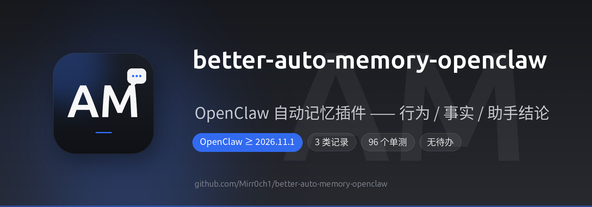

<p align="center">
  
</p>

<a href="https://github.com/Mirr0ch1/better-auto-memory-openclaw/releases/latest"></a>
<a href="https://clawhub.ai/Mirr0ch1/plugins/better-auto-memory-openclaw"></a>
<a href="https://github.com/Mirr0ch1/better-auto-memory-openclaw/blob/main/LICENSE"></a>


= 2026.11.1">


<a href="https://github.com/Mirr0ch1/better-auto-memory-openclaw/stargazers"></a>

<p align="center">
  <b>简体中文</b>
</p>

<h1 align="center">better-auto-memory-openclaw</h1>

<p align="center">
  <b>OpenClaw 自动记忆插件 —— 行为 / 事实 / 助手结论</b><br>
  每轮对话结束后压成三类记录行，写进 memory/sessions/，自动进入 memory-core 索引。
</p>

---

## 记什么，不记什么

这是本插件最重要的设计决定。**记三类，不记三类**：

| 类别 | 来源 | 记什么 |
|---|---|---|
| **行为类** | 用户发言 | 这一轮用户做了什么：提出问题 / 要求执行任务 / 查询信息 / 反馈纠正 |
| **事实类** | 用户发言 | 用户**明确说过**的：偏好 / 关系 / 计划 / 决定 |
| **助手结论类** | 助手发言 | 助手**实际完成**用户交代的任务后得出的**可复用**结论，标「助手结论：」 |

**不记**：待办、还没做完的事、一次性的结果（如「测试跑通了」「路线沿 xx 路走」）。

记下来的东西长这样：

```markdown
[米罗]提出问题：维生素 A 的过量服用量，以及一粒含 5000 单位时吃两粒的影响，[main agent] 于 2026-11-13 21:31:45 做出回答
[米罗]要求执行任务：监控 build-server-02 的部署，完成后回报最终结果，[coder agent] 于 2026-11-13 22:05:10 做出回答
[米罗]查询信息：从家里到最近地铁站的导航路线，[family agent] 于 2026-11-13 22:18:03 做出回答
[米罗]偏好：以后所有技术总结使用中文，2026-11-13 说出
[米罗]关系：同事小王和我一起负责这个项目，2026-11-13 说出
[米罗]计划：下个月把 family agent 迁移过去，2026-11-13 说出
助手结论：build-server-02 部署失败的根因是端口被占用，改用 8081 后已修复，[coder agent] 于 2026-11-13 22:05:10 完成
```

用户名、agent 名、时间戳由插件自己拼，模型不碰 —— 它抄不对这些。

像搜索引擎记录搜索历史一样：**记行为、事实与结论，不记流水账**。
agent 回答的原文还在会话里，需要时用 `sessions_history` / `sessions_search` 去翻。

### 为什么事实只能来自用户发言

用户自己说的话是事实；agent 说了什么，不许变成用户说过的话。
判定标准是**用户明确说过**：

| 用户原话 | 记成 |
|---|---|
| 「以后所有报告都用中文」 | 偏好 |
| 「同事小王和我一起负责这个项目」 | 关系 |
| 「下个月把 family agent 也迁过去」 | 计划 |
| 「就用这个插件替代官方的」 | 决定 |
| 「帮我看看 X」 | 行为类（提出问题 / 要求执行任务）—— 不是偏好 |

事实类单独拎出来，是因为行为类只回答「用户做了什么」，回答不了「用户是什么样的人」。
偏好、关系、计划、决定恰恰是长期记忆最该留的东西，却不会在任何一个「做了什么」里显形 ——
用户不会为了让你记住而特意「做一个行为」。

### 助手结论类的门槛

助手发言不是一律不记，但必须同时满足三条才写：

1. 用户在【用户发言】里明确交代了要解决这件事；
2. 助手在【助手发言】里说了这件事**已经做完**；
3. 结论是**可复用**的，不是一次性的。

不满足就整条不写：

| 助手发言 | 记不记 |
|---|---|
| 「那台机器 的根因是 transform 与入场动画冲突，改用 grid 居中后已修复」 | ✅ 记（可复用的根因） |
| 「门诊通常要预约」 | ❌ 泛泛常识，几个月后回忆起来就成了错误结论 |
| 「测试跑通了」 | ❌ 一次性结果 |
| 「大概是因为磁盘满了，你要我查一下吗」 | ❌ 没做完 + 不确定 |
| 「从家出发沿 xx 路右转，全程 15 分钟」 | ❌ 路线一次性 |

**为什么结论要标「助手结论：」**：它跟用户亲口说的不是一回事。
标清楚，召回时就不会把助手的推测当成用户的事实。

### 为什么没有「待办」

待办进长期记忆只会变成脏数据：做完的待办是垃圾，没做完的待办已经过期，
只会让召回时捞出一堆过时噪音。所以**没有待办类**：

- 用户自己说的未来打算 → 记「计划」（例：下个月把 family agent 迁过去）；
- 待确认项、待办、没做完的事（「要不要」「待定」「下次再说」）→ 一律不记。

待办该去有生命周期的地方（`ai_todo_*`、cron、日报）；记忆只存「已经确定的事」。

### 一览

| | 记 | 不记 |
|---|---|---|
| 用户发言 —— 做了什么 | ✅ 压成行为类记录行 | |
| 用户发言 —— 明确说过的偏好/关系/计划/决定 | ✅ 压成事实类记录行 | |
| 助手发言 —— 已完成任务的可复用结论 | ✅ 压成助手结论类记录行 | |
| 助手发言 —— 泛泛常识 / 一次性结果 / 没做完的推测 | | ❌ |
| 工具输出 | | ❌ |
| 待办、待确认项、还没做完的事 | | ❌ |
| 用户名 / agent 名 / 时间 | ✅ 插件自己拼 | |

**保留确定性级别**：用户说「可能 / 大概 / 也许」就保留这种不确定，说「一定 / 必须」就保留确定；
助手结论同理（「大概是因为」不写成确定原因）。不把可能写成一定，也不把一定写成可能。

## 它取代什么

OpenClaw 官方有两个往 `memory/` 写 markdown 的机制：

| 机制 | 目标文件 | 触发 | 问题 |
|---|---|---|---|
| bundled `session-memory` | `memory/YYYY-MM-DD-HHMM.md` | 只在 `/new` `/reset` auto-reset | 普通对话结束**不写**；写的是原文不是摘要 |
| `compaction.memoryFlush` | `memory/YYYY-MM-DD.md` | compaction 前跑一次静默模型回合 | 依赖模型自己写文件；慢；全局开关，无法按 agent |

本插件按 agent、按轮次、可控地完成同样的事。

## 它不做什么

- **不动** embedding provider / model / `memory.search.*`
- **不动** `memory_search` / `memory_get`（仍由 memory-core 提供）
- **不抢** `plugins.slots.memory`（memory-core 仍是唯一的 memory provider）
- **不碰** `memory/YYYY-MM-DD.md` 日报（那是 cron 任务写的）

产物落在 `memory/sessions/` 子目录 —— 既在 `memory/` tree 内（因此自动被索引），
又不跟 cron 的日报混在一起。

## 工作方式（两段式）

```
【第一段】agent_end（同步，<10ms，绝不调模型）
  ├─ 过滤自动化触发（cron / heartbeat / schedule / webhook）
  ├─ 按 idempotencyKey 水位线算本轮增量
  ├─ 脱敏（secrets 默认开，PII 默认关）
  ├─ 追加写 memory/.outbox/<sessionSlug>.jsonl
  └─ 立刻返回

【第二段】宿主调度器（延迟 50ms）
  ├─ 读 outbox 待压条目
  ├─ 把【用户发言】+【助手发言】送模型（工具输出不进）
  ├─ 调模型压成「<类别>：<描述>」（默认 agent 主模型，失败换 fallback 候选）
  ├─ 拼上用户名 / agent 名 / 时间戳 → 记录行
  ├─ 写成 memory/sessions/YYYY-MM-DD-<sessionSlug>.md（追加一节 ## HH:MM 摘要）
  └─ 从 outbox 删除该条
```

**为什么要两段式**：`agent_end` 是 observe hook，30 秒超时且**超时不会取消**插件的工作，
channel 路径还是 fire-and-forget（宿主不等）。压缩要调模型、耗时数秒，
直接在 hook 里 await 的话，Gateway 重启就丢了这次压缩。
所以第一段只做廉价的文件追加（同步、原子），第二段再慢慢压。

**Gateway 重启不丢数据**：未压缩的增量留在 outbox 里，下次启动继续压。

## 安装

从 ClawHub 装（推荐）：

```bash
openclaw plugins install clawhub:better-auto-memory-openclaw
```

从 GitHub 源码装：

```bash
openclaw plugins install git:Mirr0ch1/better-auto-memory-openclaw
```

本地开发（链接目录，改代码即时生效）：

```bash
openclaw plugins install --link /path/to/better-auto-memory-openclaw --force --accept-capabilities
```

然后在 `openclaw.json` 里加配置（**两项权限都必须开，否则功能静默失效**）：

```json5
{
  plugins: {
    allow: [..., "better-auto-memory-openclaw"],
    // 只有本地链接安装才需要 load.paths；从 ClawHub / GitHub 装的不用
    load: { paths: [..., "/path/to/better-auto-memory-openclaw"] },
    entries: {
      "better-auto-memory-openclaw": {
        enabled: true,
        // 必开：不然传 agentId 会被宿主拒绝
        llm: { allowAgentIdOverride: true, allowModelOverride: true },
        // 必开：不然 agent_end 钩子不会被注册（hookCount: 0）
        hooks: { allowConversationAccess: true },
        config: {
          agents: ["main", "coder"],
          // agentId → 用户显示名，写进记录行的方括号里。
          // 不配置则依次回退到渠道显示名、发送者 id。
          userNames: { main: "米罗", coder: "米罗" },
          summarize: {
            enabled: true,
            model: undefined,       // 不填 = agent 主模型
            reasoning: "low",
            // maxChars / maxTokens 默认留空 = 不限制，靠 prompt 里的字数要求软约束
            maxChars: undefined,
            maxTokens: undefined,
            minDeltaChars: 120,
            timeoutMs: 45000,
            includeProjectTag: false,
            redact: { secrets: true, pii: false },
          },
        },
      },
    },
  },
}
```

### ⚠️ 权限位失效是静默的

- `hooks.allowConversationAccess` 没开 → `agent_end` **不被注册**（`hookCount: 0`），
  插件照常 loaded，只在 `openclaw plugins doctor` 里有一行 warning。
- `llm.allowAgentIdOverride` 没开 → `llm.complete({ agentId })` 抛
  `LLM_COMPLETION_NOT_AUTHORIZED: cannot override the target agent`。
- `llm.allowModelOverride` 没开 → **fallback 候选链里的显式模型全被拒**，
  只有 agent 默认模型可用。

插件启动时会自检这三项并 `logger.warn`。

## 配置项

| 键 | 默认 | 说明 |
|---|---|---|
| `agents` | `["main","coder"]` | 要记录的 agent id |
| `userNames` | `{}` | `agentId → 用户显示名`。不配置则依次回退到渠道显示名、发送者 id |
| `summarize.enabled` | `true` | 关掉则只写脱敏后的原文，不调模型 |
| `summarize.model` | 未设 | `provider/model`。不填 = agent 主模型。填写需 `llm.allowModelOverride` |
| `summarize.reasoning` | `"low"` | 压缩时的思考档位 |
| `summarize.maxChars` | **留空（不限制）** | 单条摘要最大字符数。留空则不截断；prompt 里已用「总长度控制在 800 字以内」软约束 |
| `summarize.maxTokens` | **留空（不限制）** | 允许模型生成的最大 token 数。留空则不传给宿主，用模型自己的默认上限 |
| `summarize.maxInputChars` | `6000` | 送模型的原文上限 |
| `summarize.minDeltaChars` | `120` | 增量小于此值不记录、不调模型 |
| `summarize.timeoutMs` | `45000` | 单次压缩超时 |
| `summarize.includeProjectTag` | `false` | 加 `<!-- project: ... -->` 标注（memory-core 的项目加权协议） |
| `summarize.redact.secrets` | `true` | 脱敏 token / 密钥 / 账号密码 / 验证码 |
| `summarize.redact.pii` | `false` | 脱敏身份证 / 手机号 / 银行卡 / 住址 |

### 脱敏的两个开关

- **`secrets`（默认开）** —— 凭据类。**脱敏在送模型之前执行**，所以云端模型也看不到。
  覆盖西文 `key=value`、常见厂商 token 前缀、`Authorization` 头、URL 内嵌凭据，
  以及**中文自然语言**（「我的密码是：xxx」「口令是 xxx」「验证码是 xxx」「账号是 xxx」）。
- **`pii`（默认关）** —— 真人身份信息。默认关是因为记忆需要能保存身份证/手机号/住址；
  需要更严就打开。

## 失败与重试

压缩失败（所有候选模型都不可用）时：

| 尝试次数 | 行为 |
|---|---|
| 第 1、2 次 | 记录**保留在 outbox**，等下次 drain 重试。重试次数写回 outbox，**跨 Gateway 重启累计** |
| 第 3 次 | **降级**：用用户原话拼记录行（不调模型） |

降级产物的格式：

```markdown
自动摘要失败（已尝试 3 次，模型不可用），以下保留用户原始发言。

提出问题：维生素 A 服用多少算过量？……
```

**为什么要降级**：记忆不能因为模型暂时不可用就消失。降级保住内容，
只是没有归纳、没有归类。

**降级只保留用户发言**，助手结论也不会出现 —— 规则不因降级而放松。

**重试次数是按记录算的**，不是按会话：
每轮对话产生一条 outbox 记录，各自带独立的重试计数。
所以一条记录被重试 3 次降级时，落盘的是**那条记录自己的内容**（可能是几轮之前的）。

## 已知限制

- **项目分区默认关闭**：`agent_end` 的 ctx 里没有 `activeProjectKeys`（只有
  `before_prompt_build` 有），插件要自己按宿主算法算 git root。
  本机 `~/.openclaw` 本身是个 git repo（4 月升级前的一次性快照，无 remote），
  算出来的 key 对 main 和 coder **完全相同**（`path:/home/<user>/.openclaw`），区分度为零；
  而标注写错会让该 chunk 永不召回。
  要开的话得先让 workspace 落在真正的项目 git root 下（给 coder 配
  `agents.entries.coder.cwd`，或用 `agents.defaults.repoRoot`）。
- **不记自动化产出**：cron / heartbeat 触发的轮次会被跳过（本机有 56 个 cron 任务）。
- **中文脱敏是启发式**：可能误伤（例如「密码是错的」会被打码）。

## 开发

```bash
npm test              # 84 个单测
openclaw plugins reload better-auto-memory-openclaw
```

## 许可

MIT
